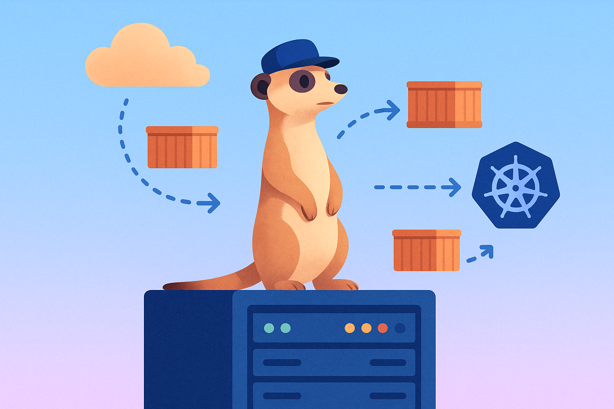

# ecr-deployman



It monitors the ECR image repository and deploys new images to Kubernetes when they are pushed.

You don't need a Github account.

You need IAM with the permission to push images to ECR and the corresponding authentication token.

This is suitable for cases where you are mainly operating Kubernetes on an in-house server.

## Assumed environment
- CI (Github Workflow, in-house Jenkins, etc.) built images are pushed to ECR
- Kubernetes deployments are operated with the latest tag
- Kubernetes is operated on an in-house server
- Slack is used

This is not valid in other environments.

## Operational Specifications
Write a configuration file in YAML, deploy it to K8s as a ConfigMap, mount it and start a Pod of this image.

It monitors a specific image tag in the configured ECR repository every minute, and if there is a change, it changes the Deployment annotation
`spec.template.metadata.annotations.imageUpdatedAt` to the image push date and time.

K8s detects the change in the manifest and updates the Pod.

## config.yaml

```yaml
awsEcrCredentials:
  - name: primary-ecr-credential
    awsAccessKeyId:
      fromEnv: AWS_ACCESS_KEY_ID
    awsSecretAccessKey:
      fromEnv: AWS_SECRET_ACCESS_KEY
    # You can also specify it directly.
    # awsAccessKeyId: AKIA...
    # awsSecretAccessKey: ......
    regionName: ap-northeast-1
    namespace: my-k8s-namespace
    secretName: ecr-credential
    # Kubeconfig settings for local execution.
    # Not required for pod execution.
    # kubeConfigFile: /Users/myname/.kube/config-mycluster
    # kubeConfigContext: None

deployments:
  - deploymentName: my-app-deployment-name
    repositoryPrefix: 000000000000.dkr.ecr.ap-northeast-1.amazonaws.com
    repositoryName: ytyng/my-app
    imageTag: latest
    namespace: my-k8s-namespace
    credentialName: primary-ecr-credential
    slackNotification:
      webhookUrl: https://hooks.slack.com/services/my-slack-webhook-url
      channel: "#my-channel"
      username: "ecr-deployman"
      iconEmoji: ":package:"
      # messagePrefix: "Some prefix message."
      messageSuffix: "https://www.ytyng.com/"
```

## pod.yaml
```yaml
apiVersion: v1
kind: Pod
metadata:
  name: ecr-deployman-pod
  namespace: ytyng
spec:
  # serviceAccountName: ecr-deployman-service-account (as needed)
  containers:
    - name: ecr-deployman
      image: ytyng/ecr-deployman:latest
      imagePullPolicy: Always
      envFrom:
        - secretRef:
            name: ecr-deployman-env

      volumeMounts:
        - mountPath: /app/config.yaml
          subPath: config.yaml
          name: ecr-deployman-config
        - mountPath: /app/storage
          name: ecr-deployman-storage

  volumes:
    - name: ecr-deployman-config
      configMap:
        name: ecr-deployman-config
    - name: ecr-deployman-storage
      hostPath:
        path: /data/ecr-deployman/storage
        type: Directory
```

## account.yaml (as needed)
```yaml
kind: ServiceAccount
apiVersion: v1
metadata:
  name: ecr-deployman-service-account
  namespace: ytyng

---

apiVersion: rbac.authorization.k8s.io/v1
kind: Role
metadata:
  namespace: ytyng
  name: ecr-deployman-role
rules:
- apiGroups: ["*"]
  resources: ["secrets", "deployments"]
  verbs: ["get", "patch", "update", "create", "delete"]

---

apiVersion: rbac.authorization.k8s.io/v1
kind: RoleBinding
metadata:
  namespace: ytyng
  name: ecr-deployman-role-binding
subjects:
- kind: ServiceAccount
  name: ecr-deployman-service-account
  namespace: ytyng
roleRef:
  kind: Role
  name: ecr-deployman-role
  apiGroup: rbac.authorization.k8s.io
```

# apply

```shell
kubectl apply -f account.yaml  # as needed
kubectl -n ytyng create configmap ecr-deployman-config --from-file=config.yaml
kubectl apply -f pod.yaml
```
